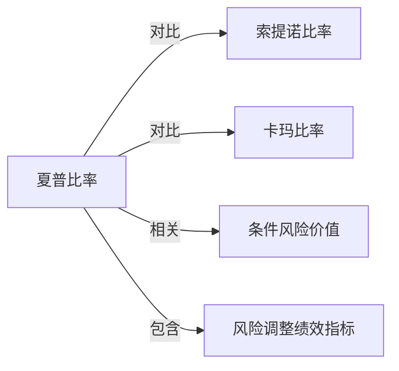

# 夏普比率

## 定义
夏普比率衡量每单位总波动风险对应的平均超额收益：

$$
\operatorname{Sharpe}=\frac{R_p-R_f}{\sigma_p},
$$

其中 $R_p$ 是组合收益率，$R_f$ 是[[无风险利率]]，$\sigma_p$ 是组合收益率[[标准差]]。

## 核心解释
夏普比率便于比较不同规模和波动水平的组合，但它把上行和下行波动同等视为风险，并依赖收益序列、频率、年化和无风险利率口径。自相关、非平稳和[[肥尾分布]]会使简单年化结果产生误导。

## 示例

假设某策略年化收益为 $12\%$，无风险利率为 $3\%$，年化波动率为 $15\%$，则

$$
\operatorname{Sharpe}=\frac{12\%-3\%}{15\%}=0.60.
$$

另一策略年化收益 $18\%$、波动率 $30\%$，则 Sharpe 为 $(18\%-3\%)/30\%=0.50$。前者的绝对收益较低，但每单位波动风险获得的超额收益更高。比较前应统一收益频率、年化方式和无风险利率期限。

## 关联概念
- [[索提诺比率]]：只使用下行偏差作为风险尺度。
- [[卡玛比率]]：使用最大回撤衡量资金曲线风险。
- [[条件风险价值]]：直接关注损失尾部。
- [[_索引_风险调整绩效|风险调整绩效指标]]：指标组合入口。

## 关系图

## 相关问题
- 高频收益存在自相关时如何修正夏普比率？
- 不同回测区间的夏普比率能否直接比较？
