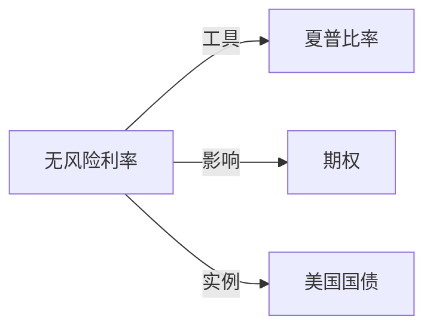

# 无风险利率

## 定义
无风险利率是在给定期限和计价货币下，不承担信用违约风险的理论资金时间价格。

## 核心解释
现实中不存在对所有期限和主体都完全无风险的单一利率，实务通常按币种、期限、抵押和结算机制选择国债收益率或隔夜指数互换曲线作为代理。口径必须与现金流期限和复利方式一致。

## 示例

若一年期国债收益率为 $4.5\%$，某组合同期收益率为 $9\%$，则相对该期限的无风险超额收益约为 $4.5$ 个百分点。若用三个月国库券利率给十年期现金流贴现，就会产生期限错配；应选择与币种、期限和抵押结构一致的曲线节点。

## 关联概念
- [[夏普比率]]：无风险利率用于计算组合超额收益。
- [[期权]]：利率影响贴现、远期价格和期权价值。
- [[美国国债]]：美元无风险利率的常用市场代理之一。

## 关系图

## 相关问题
- 国债收益率与隔夜指数互换利率应在什么场景使用？
- 负利率环境下无风险利率如何进入定价？
