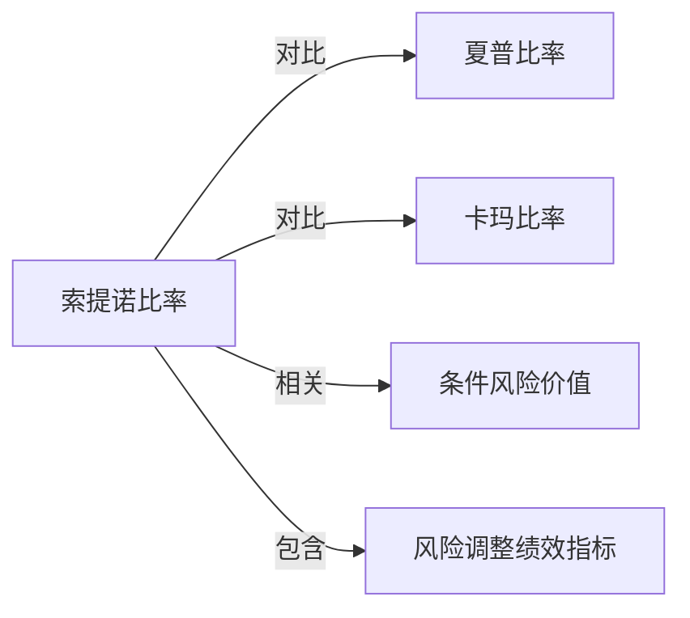

# 索提诺比率

## 定义
索提诺比率衡量每单位下行偏差对应的超额收益：

$$
\operatorname{Sortino}=\frac{R_p-R_t}{\sigma_d},
$$

其中 $R_t$ 是目标或最低可接受收益率，$\sigma_d$ 是低于目标收益的下行偏差。

## 核心解释
索提诺比率不惩罚高于目标的波动，因此比[[夏普比率]]更符合“只把不利波动视为风险”的直觉。但结果高度依赖目标收益率、样本区间和下行观测数量；它仍不能完整描述跳空和尾部损失。

## 示例

设目标收益率为 $3\%$，组合年化收益为 $12\%$，下行偏差为 $6\%$，则

$$
\operatorname{Sortino}=\frac{12\%-3\%}{6\%}=1.50.
$$

若同一组合的下行偏差上升到 $12\%$，索提诺比率降至 $0.75$。高于目标的波动不进入分母，但目标收益率的选择会直接改变结果，因此报告时应同时注明目标口径和样本区间。

## 关联概念
- [[夏普比率]]：使用全部收益标准差作为风险尺度。
- [[卡玛比率]]：关注最大回撤而非逐期下行偏差。
- [[条件风险价值]]：关注损失分布的尾部严重程度。
- [[_索引_风险调整绩效|风险调整绩效指标]]：指标组合入口。

## 关系图

## 相关问题
- 目标收益率应选择零、无风险利率还是策略要求收益？
- 下行偏差样本很少时指标是否稳定？
