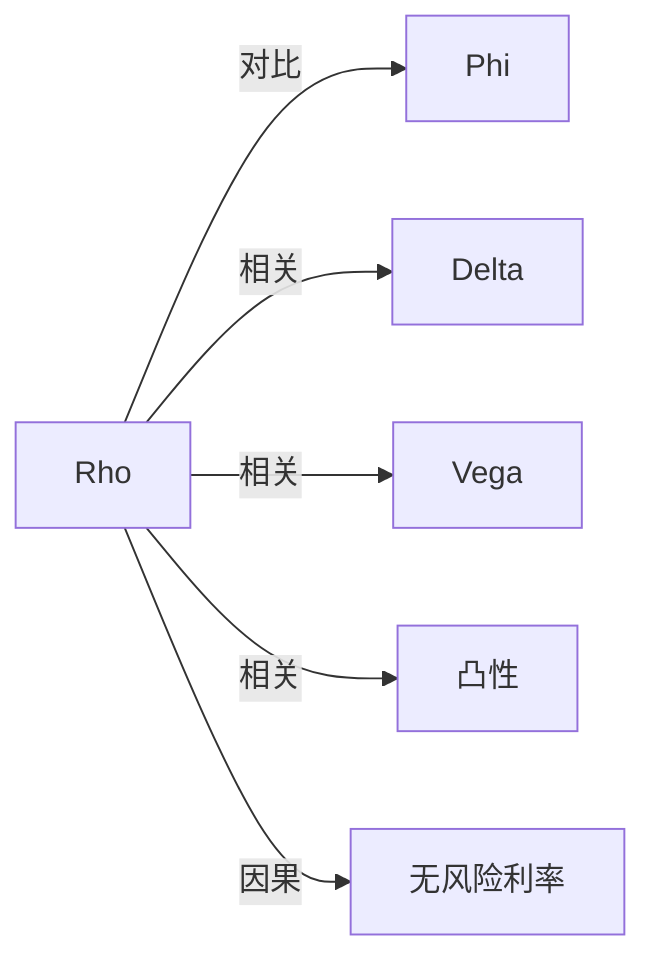

# Rho

## 定义

Rho（$\rho$）衡量期权理论价值对本国利率或主要定价利率变化的局部敏感度。

## 核心解释

Rho 衡量期权价值对主要利率输入的局部敏感度，符号和大小取决于标的、结算方式和期限。它通常不是短线期权的首要风险，但长期限和融资敏感头寸不能忽略。

## 数学表示

$$
\boxed{\rho_d=\frac{\partial V}{\partial r_d}}
$$

利率只发生小幅变化时，

$$
dV\approx\rho_d\,dr_d.
$$

若利率以小数输入，则

$$
\rho_{1\text{ percentage point}}
=0.01\frac{\partial V}{\partial r_d},
\qquad
\rho_{1\text{ bp}}
=0.0001\frac{\partial V}{\partial r_d}.
$$

不同系统可能按一个百分点、一个基点或完整小数变动报价，比较数值前必须统一单位。

## 典型形态

- 对股票型结算的股票期权，利率上升通常使看涨期权价值上升、看跌期权价值下降，因此看涨 Rho 通常为正、看跌 Rho 通常为负。
- Rho 的绝对值通常随期限增加而增大，并在深度价内期权中更显著。
- 期货型结算、股票型结算和外汇实物交割合约的现金流不同，Rho 的符号和大小不能脱离合约结构判断。

## 标的与结算差异

| 标的与结算方式 | Rho 特征 |
| --- | --- |
| 标的与期权均采用期货型结算 | 在教材框架下 Rho 为 $0$ |
| 期货期权采用股票型结算 | 看涨与看跌期权的 Rho 通常均为负 |
| 股票看涨期权 | Rho 通常为正 |
| 股票看跌期权 | Rho 通常为负 |
| 实物交割外汇期权 | 同时观察 $\rho_d$ 与 [[Phi|$\rho_f$ / $\Phi$]] |

## 风险管理含义

- 短期限小规模头寸的 Rho 往往不如 Delta、Gamma、Theta 和 Vega 显著，但长期限、融资敏感或外汇头寸不能忽略。
- 单一 Rho 相当于整条利率曲线的一个局部平行移动指标，不能完整描述曲线扭曲与基差变化。
- 组合 Rho 需按多空方向、合约数量、乘数、币种与现金流时点加总。

## 示例

若利率上升 $1$ 个百分点，某股票看涨期权理论价值从 $5.00$ 升到 $5.05$，则按一个百分点计的 Rho 约为

$$
\frac{5.05-5.00}{1}=0.05.
$$

持有 $10$ 张、乘数 $100$ 时，利率上升 $1$ 个百分点约增加 $0.05\times10\times100=50$ 个报价单位。期货型结算期权的 Rho 可能为零或符号不同，不能直接套用股票期权结论。

## 关联概念

- [[Phi|Rho-f / Phi]]：外国利率敏感度；股息率敏感度另写作 $\partial V/\partial q$。
- [[Delta]]：标的方向敏感度。
- [[Vega]]：波动率输入敏感度。
- [[凸性|期权凸性]]：利率变化较大时，还需考虑价值对利率的二阶敏感度。
- [[无风险利率]]：Rho 所对应的主要定价输入。

## 关系图

## 相关问题

- 期货型结算期权的 Rho 为什么可能为零？
- 本币与外币利率敏感度如何区分？
- 利率曲线扭曲为何不能只用单一 Rho 描述？

## 来源

- [[Knowledge/Concepts/经济/金融/衍生品/期权/References/Option Volatility and Pricing 双语版/风险度量（一） Risk Measurement I#Rho（利率敏感度） / The Rho|《Option Volatility and Pricing》第7章：Rho]]
- [[Rho（Natenberg）|Natenberg 期权知识图谱：Rho]]
