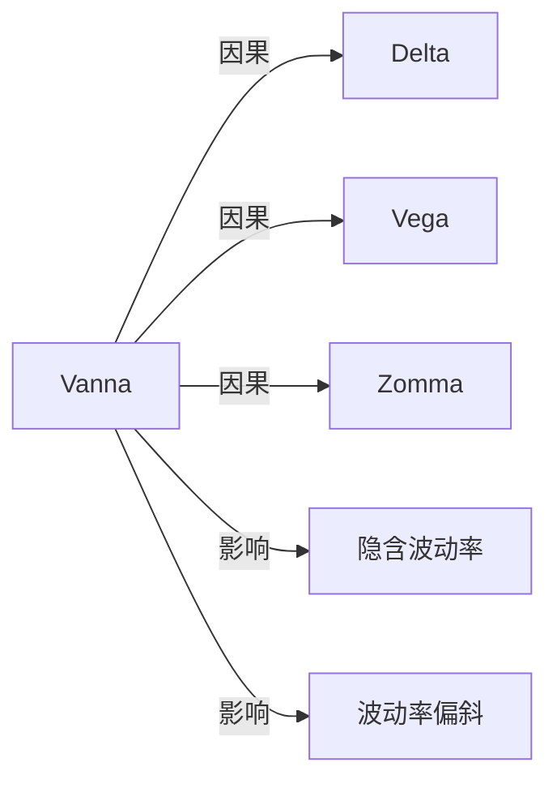

# Vanna

## 定义

Vanna 衡量 Delta 对波动率的敏感度；在偏导可交换的光滑定价模型中，它也等于 Vega 对标的价格的敏感度。

## 核心解释

Vanna 衡量 Delta 对波动率的敏感度，在光滑模型中也是 Vega 对标的价格的敏感度。它描述价格与波动率之间的交叉风险。

## 数学表示

$$
\boxed{
\mathrm{Vanna}
=\frac{\partial\Delta}{\partial\sigma}
=\frac{\partial\mathrm{Vega}}{\partial S}
=\frac{\partial^2V}{\partial S\,\partial\sigma}
}
$$

因此，在其他变量不变时，

$$
d\Delta\approx\mathrm{Vanna}\,d\sigma,
\qquad
d(\mathrm{Vega})\approx\mathrm{Vanna}\,dS.
$$

在价值的二阶展开中，Vanna 对应交叉项

$$
dV_{S,\sigma}^{(2)}
\approx\mathrm{Vanna}\,dS\,d\sigma.
$$

## 典型形态

- Vanna 具有正负波瓣，应关注绝对值与符号，而不能只说“最大”。
- 在简单模型中，Vanna 通常在平值附近接近 $0$，并在平值两侧改变符号。
- 其绝对值峰值常出现在看涨期权 Delta 约为 $0.15$–$0.20$ 与 $0.80$–$0.85$ 的区域；看跌期权对应约为 $-0.15$–$-0.20$ 与 $-0.80$–$-0.85$。
- 低波动率环境中的 Vanna 绝对值通常更大。

## 风险管理含义

若头寸当前 Delta 中性，但净 Vanna 不为 $0$，波动率变化仍会使 Delta 偏离中性：

$$
\Delta_{\text{new}}
\approx
\Delta_{\text{old}}
+\mathrm{Vanna}\,\Delta\sigma.
$$

同理，标的价格变化会通过 Vanna 改变 Vega，因此波动率风险不能只在单一现货水平上观察。

## 示例

若隐含波动率上升 $1$ 个百分点时，Delta 从 $0.50$ 变为 $0.53$，则 Vanna 约为

$$
\frac{0.53-0.50}{1}=0.03
$$

（按一个波动率百分点计）。这意味着当前 Delta 中性头寸在波动率上升后可能重新获得方向暴露；若同时发生标的价格变化，还需加入交叉项 $\mathrm{Vanna}\,\Delta S\,\Delta\sigma$。

## 关联概念

- [[Delta]]：Vanna 是 Delta 对波动率的敏感度。
- [[Vega]]：Vanna 同时是 Vega 对标的价格的敏感度。
- [[Zomma]]：Zomma 是 Vanna 对标的价格的敏感度。
- [[隐含波动率]]：波动率曲面变化会通过 Vanna 改变方向风险。
- [[波动率偏斜 Skew|波动率偏斜（Skew）]]：标的变化带动偏斜移动时，Vanna 会参与实际方向风险。

## 关系图

## 相关问题

- Vanna 为什么会有正负波瓣？
- Vanna 与 Zomma 的区别是什么？
- 偏斜移动如何改变实际 Vanna 暴露？

## 来源

- [[Knowledge/Concepts/经济/金融/衍生品/期权/References/Option Volatility and Pricing 双语版/风险度量（二） Risk Measurement II#Delta / Delta|《Option Volatility and Pricing》第9章：Vanna]]
