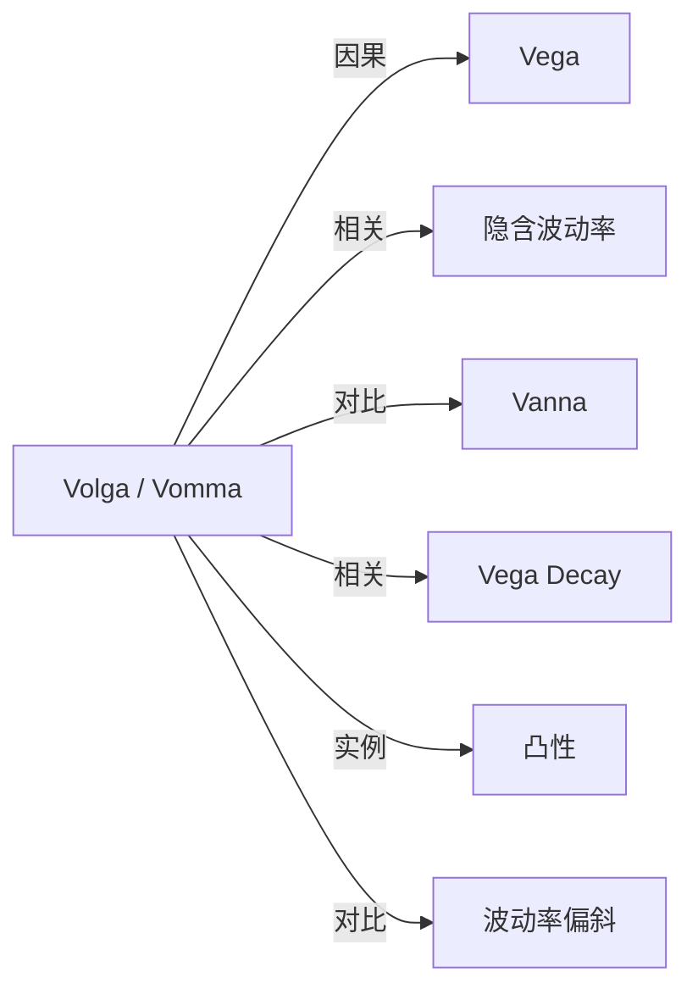

# Volga（Vomma）

## 定义

Volga（也称 Vomma）衡量 Vega 对波动率的敏感度，即期权价值相对于波动率的局部凸性。

## 核心解释

Volga（Vomma）衡量 Vega 对波动率的变化率，即期权价值相对波动率的局部凸性。波动率大幅变化时，单看 Vega 会低估或高估价值变化。

## 数学表示

$$
\boxed{
\mathrm{Volga}
=\frac{\partial\mathrm{Vega}}{\partial\sigma}
=\frac{\partial^2V}{\partial\sigma^2}
}
$$

波动率小幅变化时，Vega 的漂移为

$$
d(\mathrm{Vega})\approx\mathrm{Volga}\,d\sigma.
$$

期权价值对波动率的二阶近似为

$$
dV\approx
\mathrm{Vega}\,d\sigma
+\frac{1}{2}\mathrm{Volga}(d\sigma)^2.
$$

## 典型形态

- 平值期权的 Vega 对波动率相对稳定，因此 Volga 通常接近 $0$；在严格模型下也可能略为负。
- 价内和价外两翼的 Volga 通常为正，其绝对值峰值常在看涨 Delta 约 $0.10$ 与 $0.90$、看跌 Delta 约 $-0.10$ 与 $-0.90$ 的区域。
- 长期限、低波动率时，两翼 Volga 通常更显著。
- 多空方向会使头寸 Volga 的符号整体反转。

## 单位换算

若波动率用小数表示，而风险系统按一个波动率百分点报价，则

$$
\mathrm{Volga}_{1\text{ vol point}^2}
=0.01^2\frac{\partial^2V}{\partial\sigma^2}.
$$

比较不同系统前，应确认其 Volga 是对完整小数变化、一个波动率点，还是对 Vega 报价值再次求导。

## 示例

若波动率从 $20\%$ 升到 $21\%$ 时，Vega 从 $0.15$ 升到 $0.17$，则按一个波动率百分点计的 Volga 约为

$$
\frac{0.17-0.15}{1}=0.02.
$$

波动率再上升 $1$ 个百分点时，Vega 约增加 $0.02$；价值变化还需加入 $\frac12\mathrm{Volga}(\Delta\sigma)^2$ 的二阶项。不同系统对“一个波动率点”的定义可能不同，比较前必须统一单位。

## 关联概念

- [[Vega]]：Volga 描述 Vega 随波动率的漂移。
- [[隐含波动率]]：大幅波动率变化时，一阶 Vega 近似可能不足。
- [[Vanna]]：Vanna 描述 Vega 随标的价格的漂移。
- [[Vega Decay|Vega decay]]：Vega 随距到期时间的漂移。
- [[凸性|期权凸性]]：Volga 是期权价值相对于波动率的局部二阶凸性。
- [[波动率偏斜 Skew|波动率偏斜（Skew）]]：非平行曲面变化不能只用单一 Volga 概括。

## 关系图

## 相关问题

- 平值期权的 Volga 为什么接近零？
- Volga 与偏斜风险有何区别？
- 波动率大幅变化时为何要做全重估？

## 来源

- [[Knowledge/Concepts/经济/金融/衍生品/期权/References/Option Volatility and Pricing 双语版/风险度量（二） Risk Measurement II#Vega / Vega|《Option Volatility and Pricing》第9章：Volga / Vomma]]
